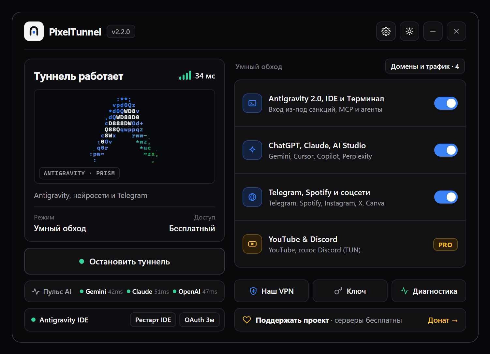
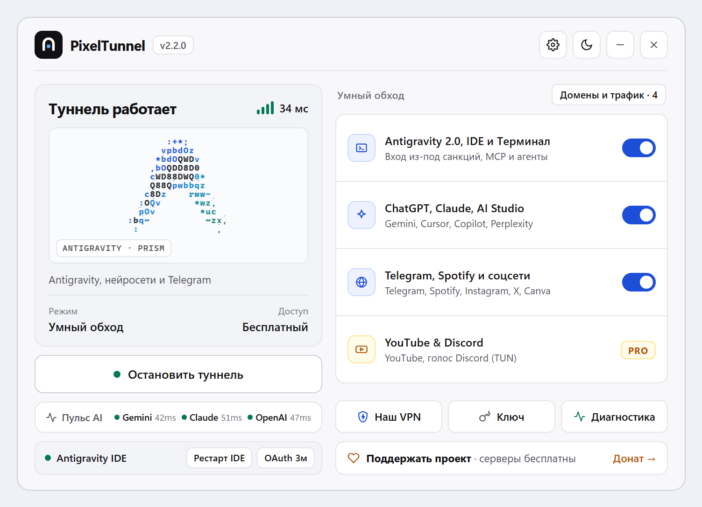
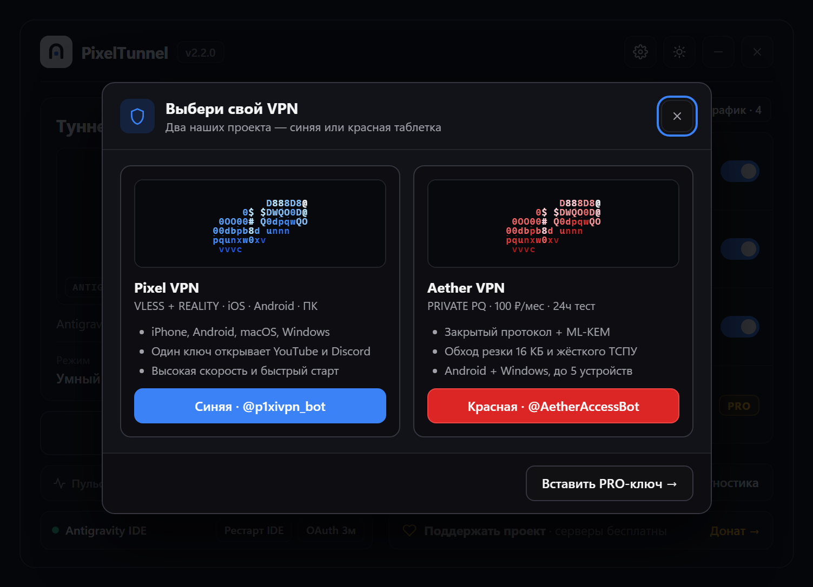
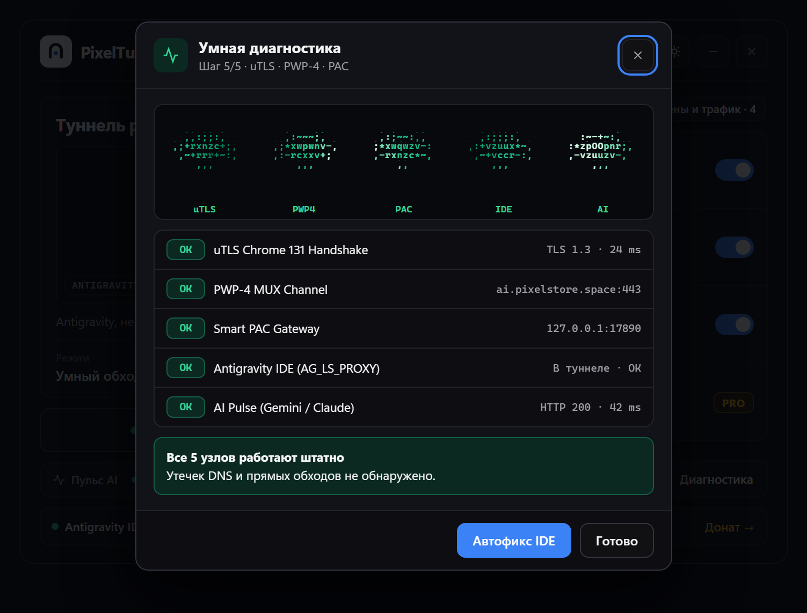
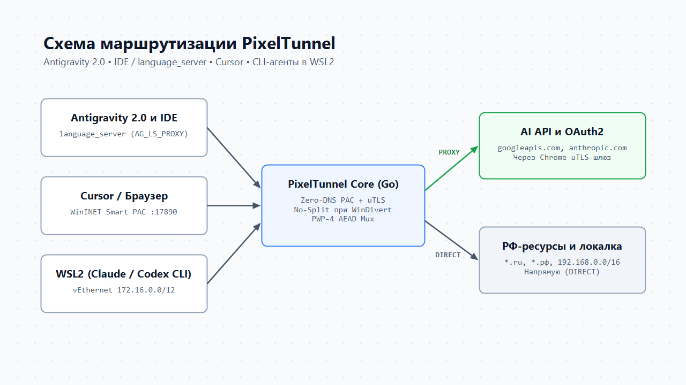

<p align="center">
  
</p>

# PixelTunnel v2.2.1 — Open-Source AI & IDE Unlocker (Antigravity, Cursor, Claude Code, Windsurf)

[](https://github.com/keenfolk1-lgtm/antigravity-unlocker/releases/latest)
[](https://github.com/keenfolk1-lgtm/antigravity-unlocker/releases/latest)
[-2ea44f)](https://github.com/keenfolk1-lgtm/antigravity-unlocker/releases/tag/v2.1.3)
[](https://pixelstore.space/)
[](https://t.me/pixel_antigravity_fix)
[](https://t.me/p1xivpn_bot)

**Open-source cross-platform split-tunneling proxy & region unlocker** for **Windows**, **macOS**, and **Linux**. Fixes `location is not supported`, OAuth2 login, MCP servers, and API timeouts in **Google Antigravity 2.0 / IDE**, **Google AI Studio**, **Cursor**, **Claude Code**, **Gemini CLI**, **Codex CLI**, **Windsurf**, **ChatGPT**, and **Claude** using a native **Chrome uTLS** Go engine, **PWP-4 AEAD** transport, and **Zero-DNS Smart PAC** — without breaking local Russian/CIS sites or conflicting with **Zapret (`winws`)** / **GoodbyeDPI**.

Лёгкий и полностью открытый клиент для **Windows**, **macOS** и **Linux** с точечной маршрутизацией трафика (Smart PAC / Split-Tunneling), нативным движком **Chrome uTLS** и шифрованным мультиплексированным транспортом **PWP-4 AEAD**.

- 📢 **Telegram-канал по обходу (обновления, гайды и помощь)**: [t.me/pixel_antigravity_fix](https://t.me/pixel_antigravity_fix)
- 🌐 **Официальный сайт / Подписки**: [pixelstore.space](https://pixelstore.space/)
- 🤖 **Telegram-бот (PRO-ключи, YouTube, Discord, iOS/Android)**: [@p1xivpn_bot](https://t.me/p1xivpn_bot)
- 📦 **Скачать готовый билд**: [GitHub Releases (v2.2.1)](https://github.com/keenfolk1-lgtm/antigravity-unlocker/releases/latest)

<p align="center">
  
  <br />
  <sub>Интерфейс PixelTunnel v2.2.0 (Obsidian Precision · PRISM ASCII · Windows WPF + встроенное Go uTLS ядро)</sub>
</p>

<table>
  <tr>
    <td align="center" width="33%"><br /><sub>Адаптивная светлая тема</sub></td>
    <td align="center" width="33%"><br /><sub>Наш VPN · 3D ASCII-капсулы</sub></td>
    <td align="center" width="33%"><br /><sub>Диагностика · 5-узловой ASCII-сканер</sub></td>
  </tr>
</table>



## Что нового в v2.2.1
- **Авто-патчер Antigravity `language_server` для Linux и macOS**: при запуске `pixeltunnel start` и через новую команду `pixeltunnel patch [--check] [--tiers-only] [--path <binary>]` движок автоматически патчит `language_server` (`ineligible_tiers` / `ineligibleTiers` → обход ограничения региона аккаунта + `HTTPS_PROXY` → `AG_LS_PROXY`), выполняет атомарную замену без `ETXTBSY`, применяет ad-hoc `codesign` на macOS Apple Silicon и мягко перезапускает затронутый `language_server`.
- **Проброс `AG_LS_PROXY` и проверка в Diagnostics 4.0**: `pixeltunnel env` теперь экспортирует `AG_LS_PROXY`, на Linux дополнительно обновляется `dbus-update-activation-environment --systemd AG_LS_PROXY`, а `pixeltunnel doctor` (`cardIDESockets`) проверяет наличие и состояние патча `language_server`.

## Что нового в v2.2.0
- **Новый интерфейс Obsidian Precision v2.2 + PRISM ASCII**: двухколоночное окно без пустых зазоров, живая переливающаяся ASCII-эмблема Google Antigravity, адаптивная светлая/тёмная тема (`#FAFBFD` / `#08090D`), 3D ASCII-капсулы выбора VPN в «Наш VPN» и живой 5-узловой ASCII-сканер (`uTLS · PWP4 · PAC · IDE · AI`) в «Умной диагностике».
- **Улучшения Smart PAC и правил маршрутизации (Go-ядро)**: мгновенная санитизация и корректный откат при удалении пользовательских доменов, поддержка временных прокси-правил с авто-истечением по TTL без записи на диск и единый список системных прямых исключений.
- **Стабильность TUN/UDP, NAT и Instant Wake**: 2-секундная дедупликация пробуждения `Instant Wake`, неблокирующая очередь приёма UDP в TUN, строгая изоляция NAT по паре `(srcIP, srcPort)` и коалесинг UDP-событий в RouteRadar.

## Что нового в v2.1.4
- **Полная поддержка Google AI Studio и Gemini в браузере**: добавлены домены `ai.studio`, `usercontent.goog`, `cloud.google`, `run.app`, `web.app`, `firebaseapp.com`, `appspot.com`, `withgoogle.com`, `google.dev`, `alkalimakersuiteapplets.pa.clients6.google.com`, `webchannel-alkalimakersuite-pa.clients6.google.com`, а также все поддомены Google AI Studio / Build & Preview.
- **Google AI Studio в категории «ChatGPT, Claude, AI Studio и нейросети»**: теперь `aistudio.google.com`, `ai.studio` и `gemini.google.com` проксируются как при включённой галочке `Antigravity IDE`, так и при включённой категории нейросетей отдельно.
- **Исправлен резервный C# Smart PAC и добавлена проверка AI Studio**: из резервного генератора PAC удалены локальные DNS-вызовы `isInNet` и небезопасный fallback `; DIRECT`, а в сквозную диагностику добавлена проверка `aistudio.google.com`.

## Что нового в v2.1.3
- **Совместимость с `zapret` (`winws.exe`), `GoodbyeDPI` и `ByeDPI`**: автоматическое обнаружение активных WinDivert/DPI-утилит и переключение TLS-рукопожатия в режим `No-Split` без двойной фрагментации пакетов (шаг адаптации увеличен до `3500 мс`).
- **Корректная работа со всеми ключами `@p1xivpn_bot` и чужих VPN**: полная нормализация Reality-ключей `node.pixelstore.space`, мгновенный возврат понятных ошибок лицензии (`DEVICE_LIMIT`, `KEY_EXPIRED`, `INVALID_KEY`) и защита от чужих ключей (`vmess://`, `ss://`, сторонний `vless://`) с кнопкой «Сбросить на FREE».
- **Оптимизация ОЗУ и проверка Microsoft Defender**: жёсткий лимит памяти Go-ядра (`GOMEMLIMIT=96MiB`), увеличенный таймаут запуска под облачной проверкой Defender (`8 с`), устранена реентерабельность фонового цикла и случайное включение TUN без PRO-подписки. Заявка на сборку `v2.1.3` проверена Microsoft Security Intelligence (`Submission Completed — детект удалён`).
- **Встроенная диагностика без `curl.exe`**: HTTP-зонды работают напрямую через `HttpWebRequest`, подписанный офлайн-манифест `nodes_v3.enc` вшит в сборку, а в конце отчёта выводится готовый список **«Рекомендации (что сделать сейчас)»**.

## Ключевые возможности v2.0+
- **Транспорт PWP-4 AEAD (`ChaCha20-Poly1305` + `HKDF-SHA256`)**: аутентифицированное шифрование кадров, маскировка длины кадра с проверкой целостности (AD), padding и автоматический rekey сессии — с прозрачным fallback на **PWP-3** для обратной совместимости.
- **Chrome uTLS движок (`src/go-engine`, `CGO_ENABLED=0`)**: имитация TLS-отпечатка браузера Chrome (`HelloChrome_Auto`, fallback `HelloFirefox_Auto`), фрагментация `ClientHello` и строгий SPKI SHA-256 pinning (в Windows GUI встроен внутрь `PixelTunnel.exe` с безопасным fallback на C#-движок).
- **Smart PAC по умолчанию (`Zero-DNS`)**: чистый JS PAC на `http://127.0.0.1:17890/proxy.pac` без вызовов `dnsResolve()`, прямое прохождение локальных сетей и `.ru`/`.рф`/`.su`/`.by` доменов, плюс опция классического системного прокси (`ProxyEnable=1`) и аварийный `RunOnce` сброс.
- **Диагностика 4.0 «Сетевой Рентген»**: неразрушающие проверки по 6 карточкам (провайдер и Hosts, тест ТСПУ 64 КБ DL / 32 КБ MTU UL, Chrome uTLS и антивирусный SSL MITM, матрица узлов и горячий резерв, сокеты IDE по PID, живой «Пульс AI» для Gemini / Claude / OpenAI), «Живой радар» маршрутов с добавлением доменов в 1 клик и полностью локальный отчёт.
- **Instant Wake & Zero-Drop Hot-Failover**: отслеживание пробуждения после сна и смены сети, предварительно прогретая резервная сессия и мгновенное переключение при зависании канала.
- **Мост для WSL2 и CLI-агентов**: безопасная привязка только к подсети адаптера `vEthernet (WSL)` (`172.16.0.0/12`, без `0.0.0.0`) и готовый вывод переменных `HTTP_PROXY` / `HTTPS_PROXY` / `ALL_PROXY=socks5h://` для Claude Code, Codex CLI, Gemini CLI и терминалов IDE.
- **macOS, Linux и активация PRO в 1 клик**: нативный CLI + тёмный локальный Web-UI (`/ui` с cookie + CSRF-защитой) и поддержка deep-link `pixeltunnel://activate?key=...` из [@p1xivpn_bot](https://t.me/p1xivpn_bot).

## Быстрая установка

### Windows (x64)
1. Скачайте **`PixelTunnel.exe`** со страницы [GitHub Releases](https://github.com/keenfolk1-lgtm/antigravity-unlocker/releases/latest).
2. Запустите файл (установка не требуется).
3. Для PRO-доступа нажмите **«⚡ Активировать PRO в 1 клик»** в [@p1xivpn_bot](https://t.me/p1xivpn_bot) или вставьте свой ключ/ссылку в окне программы.

### macOS (Apple Silicon M1–M4 / Intel) и Linux (x64 / ARM64)
Установка одной командой (определяет архитектуру, проверяет `SHA256SUMS.txt` и регистрирует `pixeltunnel://`):

```sh
curl -fsSL https://raw.githubusercontent.com/keenfolk1-lgtm/antigravity-unlocker/main/install.sh | sh
```

Запуск и управление:
```sh
pixeltunnel start            # запуск туннеля и вывод ссылки панели http://127.0.0.1:17890/ui?t=...
pixeltunnel activate <ключ>  # активация PRO-ключа (UUID, vless://, pwp4:// или подписка)
pixeltunnel status           # статус подключения и узлов
pixeltunnel doctor           # консольная диагностика Network X-Ray 4.0
eval "$(pixeltunnel env)"    # экспорт прокси-переменных для CLI-агентов в текущей оболочке
```

## Что работает бесплатно и бессрочно
- **Antigravity 2.0, IDE и Терминал** — вход, плагины, MCP-серверы и AI-агенты
- **ChatGPT, Claude, Gemini, Cursor и нейросети** — Copilot, Midjourney, Suno, ElevenLabs, Perplexity
- **Telegram, Spotify и соцсети** — Telegram (включая настройку SOCKS5 в 1 клик), Spotify, Instagram, X, LinkedIn, Canva
- **Совместимость с Zapret / GoodbyeDPI** — в бесплатном режиме домены YouTube и Discord идут напрямую (`DIRECT`) и не конфликтуют со сторонними обходами

Для **YouTube & Discord** без сторонних утилит и полноценного VPN на **iPhone / Android / ПК / Mac / Linux** можно подключить персональный PRO-ключ из [@p1xivpn_bot](https://t.me/p1xivpn_bot).

## Сборка из исходников

### Windows (WPF + встроенный Go uTLS движок)
Требуется **Go 1.26+** и встроенный в Windows **.NET Framework 4.x (`csc.exe`)**:

```powershell
# Сборка PixelTunnel.exe со встроенным Go Chrome uTLS движком:
powershell -ExecutionPolicy Bypass -File .\build.ps1

# Кросс-сборка для всех 5 платформ + dist\SHA256SUMS.txt:
powershell -ExecutionPolicy Bypass -File .\build.ps1 -AllPlatforms
```

На выходе появится готовый `PixelTunnel.exe` в корне репозитория (и кроссплатформенные бинарники в `dist/` при `-AllPlatforms`).

### macOS / Linux (Go CLI + Web-UI)
```sh
cd src/go-engine
CGO_ENABLED=0 go build -buildvcs=false -trimpath -ldflags="-s -w" -o pixeltunnel .
```

## Безопасность и проверка
- Весь исходный код открыт: Windows UI/хост в `src/` (`PixelTunnelNext.cs`, `PixelCoreEngineV3.cs`, `PixelTunnelAsciiRenderer.cs`) и кроссплатформенный Go uTLS движок в `src/go-engine/`.
- Конфигурация узлов (`nodes_v3.enc`) и обновления проверяются по цифровой подписи **ECDSA P-256** и хэшу **SHA-256** с персистентной защитой от отката версии.
- Установщик `install.sh` проверяет контрольные суммы по `SHA256SUMS.txt`, а все бинарники и `go test ./...` / `--genconfig` проверяются автоматически через [GitHub Actions](.github/workflows/build.yml).
